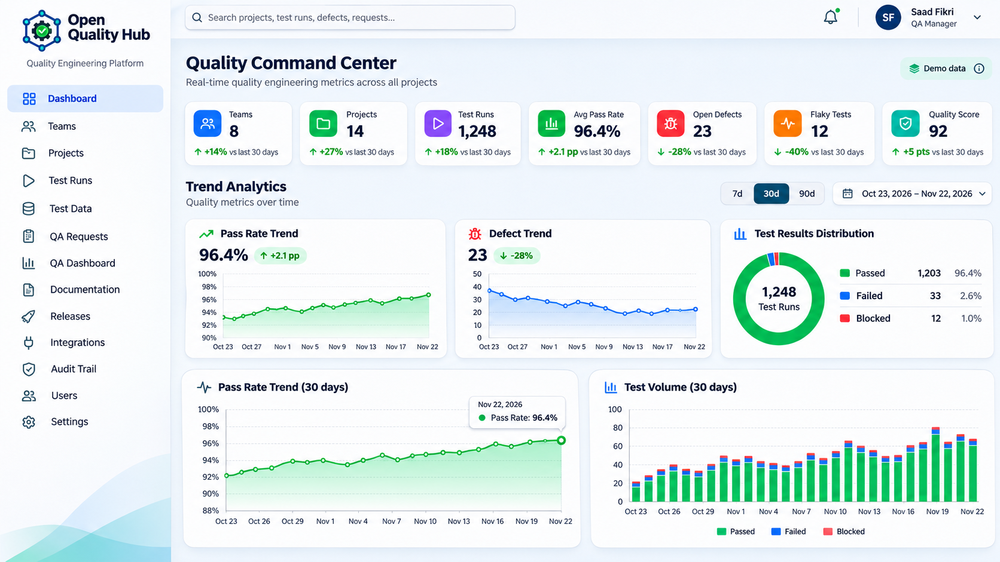

<div align="center">


### Quality Engineering & Test Management Platform

One command center for test intelligence, release confidence, and cross-team QA governance.

[](https://github.com/saadfikri/OpenQualityHub/releases)
[](https://github.com/saadfikri/OpenQualityHub/actions/workflows/ci.yml)
[](https://github.com/saadfikri/OpenQualityHub)
[](https://github.com/saadfikri/OpenQualityHub)
[](LICENSE)
[](https://openjdk.org/projects/jdk/21/)
[](https://spring.io/projects/spring-boot)
[](https://react.dev/)
[](https://www.postgresql.org/)
[](CONTRIBUTING.md)

[Website](https://openqualityhub.org) · [Getting Started](#-getting-started) · [API Docs](#-api-reference) · [Contributing](CONTRIBUTING.md)

</div>

---

## Why Open Quality Hub?

Most QA teams juggle fragmented tools — test results in CI logs, defects in Jira, metrics in spreadsheets, and no single source of truth.

Open Quality Hub brings the entire quality lifecycle into one platform:

- **Centralize** test results from 6 frameworks — JUnit, Playwright, Cypress, TestNG, WebdriverIO, Maestro
- **Detect** flaky tests with stable fingerprinting and trend analysis
- **Analyze** failures with AI-powered root cause categorization (Claude)
- **Track** release readiness with weighted scoring (40/30/30), quality gates, and multi-role sign-off
- **Monitor** mobile testing with device compatibility matrix and flow analytics
- **Manage** cross-team QA requests with SLA monitoring and capacity planning
- **Generate** synthetic test data with 11 field types and 6 strategies

<div align="center">

<p><em>Quality Command Center — real-time metrics across all projects</em></p>
</div>

## Capabilities

| Area | What it does |
|------|-------------|
| **Quality Dashboard** | Pass rate trends, defect density, automation coverage, quality scorecards, streaming CSV export |
| **Test Intelligence** | Flaky test detection, stable fingerprinting, AI failure analysis (9 categories, confidence scoring) |
| **Release Confidence** | 40/30/30 weighted readiness scoring, severity-aware defect impact, policy-based quality gates, sign-off chain (QA Lead → EM → PO) |
| **Maestro Mobile Testing** | Device compatibility matrix, flow analytics, top failing flows, platform summary, dual-format JSON parser (CLI + Cloud), webhook integration |
| **Cross-Team QA** | Service catalog, 8-state request lifecycle, SLA breach alerts, capacity planning |
| **CI/CD Integrations** | Webhook ingestion with HMAC validation, GitHub/GitLab/Jenkins/Jira connectors, Maestro Cloud webhooks |
| **Documentation** | Asset health scoring, review workflows, staleness detection |
| **Test Data** | Synthetic generation with Datafaker — random, boundary, edge case, localization strategies |
| **Security** | JWT auth (access + refresh tokens), 5 system roles, 39+ permissions, rate limiting, audit trail, SSE notifications |

## Architecture

```
┌─────────────────────────────────────────────────────────────────┐
│                        React 19 + TypeScript                     │
│               Tailwind CSS · React Query · Recharts              │
├─────────────────────────────────────────────────────────────────┤
│                     REST API (25 Controllers)                    │
│            JWT Auth · RBAC · Rate Limiting · CORS                │
├──────────┬──────────┬──────────┬──────────┬─────────────────────┤
│  Test    │ Release  │  QA      │ Maestro  │   AI Analysis       │
│ Intel    │ Confid.  │ Request  │ Mobile   │   (Claude API)      │
│ Engine   │ Engine   │ Engine   │ Engine   │                     │
├──────────┴──────────┴──────────┴──────────┴─────────────────────┤
│            Spring Boot 3.2 · MapStruct · Caffeine Cache          │
│         Flyway · JPA/Hibernate · Streaming Exports               │
├─────────────────────────────────────────────────────────────────┤
│        PostgreSQL 17 · JSONB · Partial Indexes · GIN FTS         │
└─────────────────────────────────────────────────────────────────┘
```

**Key numbers:** 42 entities · 40 repositories · 25 controllers · 6 Flyway migrations · 10 performance indexes

## Tech Stack

| Layer | Technologies |
|-------|-------------|
| **Frontend** | React 19 · TypeScript · Tailwind CSS v4 · Vite 8 · React Query · Recharts · Axios |
| **Backend** | Java 21 · Spring Boot 3.2 · MapStruct 1.5 · Lombok · JJWT 0.12 · Caffeine Cache |
| **Database** | PostgreSQL 17 · JSONB columns · Full-text search (GIN) · Partial indexes · Flyway migrations |
| **AI** | Anthropic Claude API · Async analysis pipeline · Graceful degradation · Human feedback loop |
| **Testing** | JUnit 5 · Mockito (563 unit tests) · Playwright (52 E2E tests) · JaCoCo coverage |
| **DevOps** | Docker · GitHub Actions (CI/CD) · Multi-stage builds |

## Getting Started

### Prerequisites

- Java 21+
- Node.js 18+
- PostgreSQL 17+

### Docker (recommended)

```bash
git clone https://github.com/saadfikri/OpenQualityHub.git
cd OpenQualityHub
docker-compose up -d
```

### Manual Setup

```bash
# 1. Create the database
createdb openqualityhub

# 2. Start the backend (auto-runs Flyway migrations)
cd backend
mvn spring-boot:run

# 3. Start the frontend
cd frontend
npm install && npm run dev
```

The app runs at **http://localhost:5173** — API at **http://localhost:8080**.

### Demo Account

| Email | Password | Role |
|-------|----------|------|
| `sarah.chen@demo.oqh` | `Demo123!` | Admin (full access) |

### Import Your First Test Results

```bash
# Import JUnit XML results
curl -X POST http://localhost:8080/api/v1/test-runs/import/junit \
  -H "Authorization: Bearer <token>" \
  -F "projectId=<project-uuid>" \
  -F "name=Nightly Suite" \
  -F "file=@test-results.xml"

# Import Maestro mobile test results
curl -X POST http://localhost:8080/api/v1/maestro/import \
  -H "Authorization: Bearer <token>" \
  -F "projectId=<project-uuid>" \
  -F "name=Mobile Regression" \
  -F "file=@maestro-results.json"
```

## API Reference

Full Swagger UI available at **http://localhost:8080/swagger-ui.html** after starting the backend.

**Key endpoints:**

| Method | Endpoint | Description |
|--------|----------|-------------|
| `POST` | `/api/v1/auth/login` | Authenticate and get JWT tokens |
| `POST` | `/api/v1/test-runs/import/{format}` | Import test results (junit, playwright, cypress, testng, webdriverio, maestro) |
| `GET` | `/api/v1/dashboard` | Quality metrics dashboard |
| `POST` | `/api/v1/releases/{id}/readiness` | Generate release readiness report |
| `GET` | `/api/v1/maestro/dashboard` | Maestro device matrix & flow analytics |
| `POST` | `/api/v1/webhooks/{provider}` | Receive CI/CD webhook events |

## Testing

```bash
# Backend unit tests (563 tests)
cd backend && mvn test

# E2E tests (52 Playwright tests)
cd frontend && npx playwright test

# Test with coverage report
cd backend && mvn test jacoco:report
# Report at: backend/target/site/jacoco/index.html
```

## Roadmap

- [x] Multi-framework test import (JUnit, Playwright, Cypress, TestNG, WebdriverIO)
- [x] Maestro mobile testing integration (device matrix, flow analytics, webhooks)
- [x] AI-powered failure analysis (Claude)
- [x] Release confidence scoring with quality gates
- [x] Performance optimization (Caffeine cache, streaming exports, aggregated queries)
- [ ] GitHub Actions integration (parser + webhook processor)
- [ ] Jenkins pipeline integration
- [ ] Email notifications (SMTP)
- [ ] LDAP/SSO authentication
- [ ] Test case management module
- [ ] Grafana/Prometheus metrics export
- [ ] Multi-language support (i18n)
- [ ] Public API with API key authentication

## Contributing

We welcome contributions — see our [Contributing Guide](CONTRIBUTING.md) for setup instructions, code style, and PR process.

## Security

If you discover a security vulnerability, please report it responsibly by emailing **ss.fikri@gmail.com** instead of opening a public issue.

## License

[GNU Affero General Public License v3.0](LICENSE)

---

<div align="center">

**Built for the people behind software quality.**

[Report a Bug](https://github.com/saadfikri/OpenQualityHub/issues) · [Request a Feature](https://github.com/saadfikri/OpenQualityHub/issues) · [Star the Repo](https://github.com/saadfikri/OpenQualityHub)

</div>
